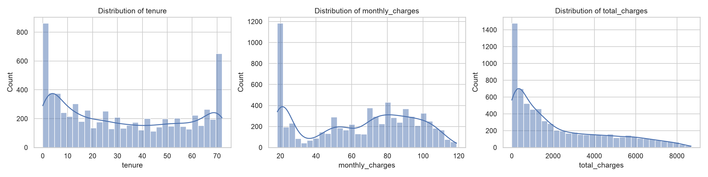
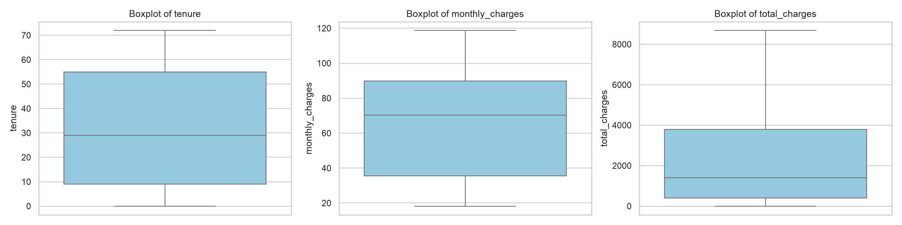
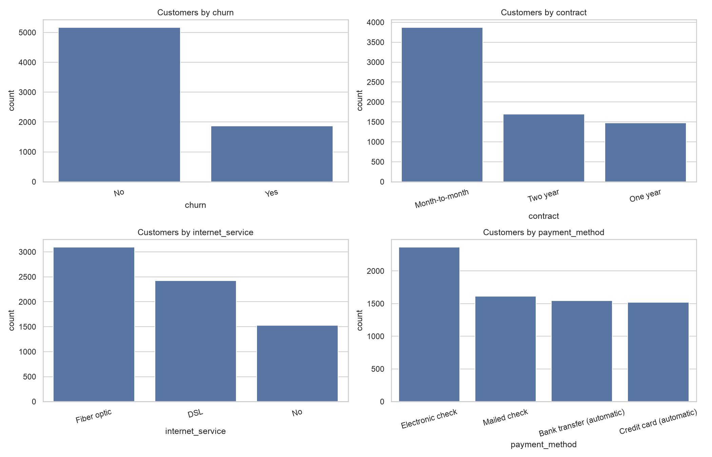
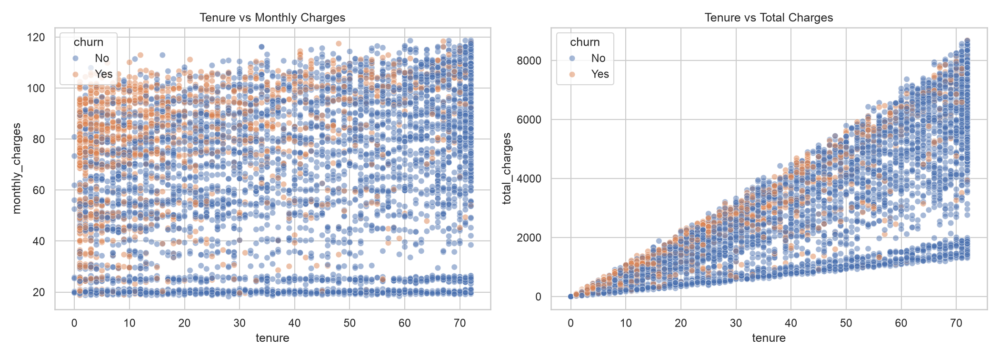
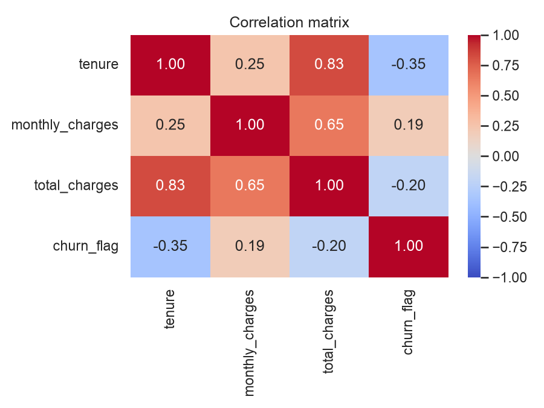
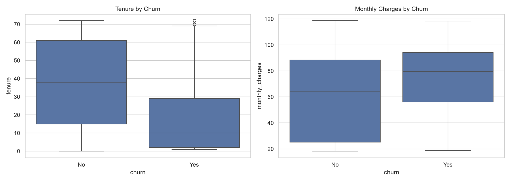
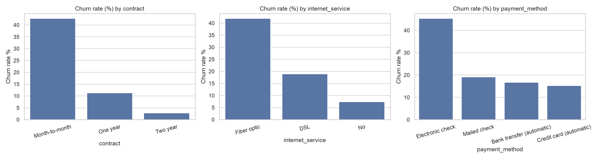

# 📊 Telco Customer Churn: Exploratory Data Analysis


> **ApexPlanet Software Pvt. Ltd. | Data Analytics Internship | Task 1**
> Foundational Setup & Exploratory Data Analysis (EDA)

A complete, reproducible data cleaning and exploratory analysis of a telecom customer dataset, built to find **why customers leave (churn)** and what a business can do about it.

---

## 📑 Table of Contents
1. [Project Overview](#-project-overview)
2. [Business Problem & Objectives](#-business-problem--objectives)
3. [Dataset](#-dataset)
4. [Data Dictionary](#-data-dictionary)
5. [Tech Stack](#-tech-stack)
6. [Project Structure](#-project-structure)
7. [Setup & Installation](#-setup--installation)
8. [How to Run](#-how-to-run)
9. [Methodology](#-methodology)
10. [Key Findings](#-key-findings)
11. [Visualizations](#-visualizations)
12. [Business Recommendations](#-business-recommendations)
13. [Limitations](#-limitations)
14. [Future Work](#-future-work)
15. [Deliverables](#-deliverables)
16. [Author](#-author)

---

## 🔎 Project Overview

Customer churn is one of the costliest problems for subscription businesses, because winning a new customer is usually more expensive than keeping an existing one. This project analyses the **IBM Telco Customer Churn** dataset to understand which customers leave and which factors are linked to leaving.

The work covers the full first stage of an analytics project:

- Setting up a professional analytics environment and repository structure
- Sourcing and understanding a real-world dataset
- Cleaning and preprocessing messy data (type errors, blanks, duplicates, outliers)
- Running univariate and bivariate exploratory analysis
- Documenting findings with clear, business-focused insights

---

## 🎯 Business Problem & Objectives

**Business question:** *Which customers are most likely to churn, and what do they have in common?*

**Objectives**
- Build a clean, analysis-ready dataset from raw data
- Document every cleaning decision in a transparent cleaning log
- Describe the distribution of customer tenure, charges and service choices
- Identify the relationships between customer attributes and churn
- Turn the findings into practical retention recommendations

---

## 📦 Dataset

| Item | Details |
|---|---|
| **Name** | Telco Customer Churn |
| **Source** | [Kaggle: blastchar/telco-customer-churn](https://www.kaggle.com/datasets/blastchar/telco-customer-churn) (IBM sample data) |
| **Rows** | 7,043 customers |
| **Columns** | 21 in the raw file (22 after cleaning, with the added `churn_flag`) |
| **Target** | `Churn` (Yes / No) |
| **Granularity** | One row per customer |

**Collection method:** Each row captures a telecom customer's demographics, account details, subscribed services, billing information and whether they left within the last month.

---

## 📖 Data Dictionary

| Column | Type | Description |
|---|---|---|
| `customerID` | Text | Unique customer identifier |
| `gender` | Categorical | Male / Female |
| `SeniorCitizen` | Binary | 1 if the customer is a senior citizen |
| `Partner` | Categorical | Whether the customer has a partner |
| `Dependents` | Categorical | Whether the customer has dependents |
| `tenure` | Numeric | Number of months the customer has stayed |
| `PhoneService` | Categorical | Whether the customer has phone service |
| `MultipleLines` | Categorical | Multiple phone lines (Yes / No / No phone service) |
| `InternetService` | Categorical | DSL / Fiber optic / No |
| `OnlineSecurity`, `OnlineBackup`, `DeviceProtection`, `TechSupport` | Categorical | Add-on internet services |
| `StreamingTV`, `StreamingMovies` | Categorical | Streaming services |
| `Contract` | Categorical | Month-to-month / One year / Two year |
| `PaperlessBilling` | Categorical | Whether billing is paperless |
| `PaymentMethod` | Categorical | Electronic check, mailed check, bank transfer, credit card |
| `MonthlyCharges` | Numeric | Current monthly bill |
| `TotalCharges` | Numeric | Total amount billed over the customer's tenure |
| `Churn` | Categorical | **Target:** whether the customer left |

---

## 🛠 Tech Stack

| Purpose | Tools |
|---|---|
| Language | Python 3.10+ |
| Data manipulation | pandas, NumPy |
| Visualization | Matplotlib, Seaborn (Plotly installed for later tasks) |
| Environment | Jupyter Notebook, virtual environment (venv / conda) |
| Version control | Git, GitHub |

---

## 🗂 Project Structure

```
telco-customer-churn-analysis/
├── data/
│   ├── raw/                     # Original, untouched dataset
│   │   └── Telco-Customer-Churn.csv
│   └── processed/               # Cleaned dataset used for analysis
│       └── telco_churn_clean.csv
├── notebooks/
│   └── 01_eda.ipynb             # Full cleaning + EDA with explanations
├── scripts/
│   └── clean_data.py            # Reproducible cleaning pipeline
├── reports/
│   ├── cleaning_log.md          # Record of every cleaning step
│   └── figures/                 # Exported charts (PNG)
├── dashboards/                  # Reserved for upcoming BI tasks (Power BI / Tableau)
├── requirements.txt
├── .gitignore
└── README.md
```

---

## ⚙ Setup & Installation

### Prerequisites
- Python 3.10 or higher
- Git (optional, for cloning)

### 1. Clone the repository
```bash
git clone https://github.com/<your-username>/telco-customer-churn-analysis.git
cd telco-customer-churn-analysis
```

### 2. Create a virtual environment

**Option A: venv**
```bash
python3 -m venv .venv
source .venv/bin/activate        # macOS / Linux
# .venv\Scripts\activate         # Windows
```

**Option B: conda**
```bash
conda create -n analytics python=3.10 -y
conda activate analytics
```

### 3. Install dependencies
```bash
pip install -r requirements.txt
```

### 4. Add the dataset
Download the CSV from [Kaggle](https://www.kaggle.com/datasets/blastchar/telco-customer-churn), rename it to `Telco-Customer-Churn.csv` and place it in `data/raw/`.

---

## ▶ How to Run

**Notebook (recommended):**
```bash
jupyter notebook
```
Open `notebooks/01_eda.ipynb` and choose **Run → Run All Cells**.

**Cleaning script only:**
```bash
python scripts/clean_data.py
```

**Outputs created**
- `data/processed/telco_churn_clean.csv`
- `reports/cleaning_log.md`
- `reports/figures/*.png` (7 charts)

---

## 🧪 Methodology

### 1. Data understanding
Loaded the raw CSV into a pandas DataFrame, inspected shape, data types, the data dictionary and basic quality problems.

### 2. Data cleaning & preprocessing

| Step | Issue found | Action taken |
|---|---|---|
| Column names | Mixed `CamelCase` and inconsistent style | Converted all columns to `snake_case` |
| Data types | `TotalCharges` stored as text | Converted to numeric with `pd.to_numeric` |
| Missing values | 11 blank `TotalCharges` values | All belong to customers with `tenure = 0` (not yet billed), so filled with `0` |
| Duplicates | Checked full rows and `customerID` | Removed any duplicates (none found in the original data) |
| Categorical data | Text columns, `SeniorCitizen` coded 0/1 | Converted to `category`; mapped `SeniorCitizen` to No / Yes |
| Target encoding | `Churn` is Yes / No | Added numeric `churn_flag` (1 = churned) for calculations |
| Outliers | Checked `tenure`, `monthly_charges`, `total_charges` | IQR and z-score checks; values kept because they are valid customers |

Every transformation is saved in [`reports/cleaning_log.md`](reports/cleaning_log.md).

### 3. Exploratory data analysis
- **Statistical summary:** `describe()`, `info()`, `value_counts()`
- **Univariate:** histograms, boxplots and bar charts
- **Bivariate:** scatter plots, correlation heatmap, churn rate by category, tenure and charges split by churn
- **Insight documentation:** findings written in the notebook with markdown explanations

---

## 💡 Key Findings

> Figures below are the commonly reported values for this dataset. Confirm them against the output of the final notebook cell and adjust if your run differs.

1. **Overall churn is about 26.5%.** Roughly 1 in 4 customers left, so the classes are moderately imbalanced.
2. **Contract type is the strongest driver.** Month-to-month customers churn at roughly 43%, versus about 11% on one-year and about 3% on two-year contracts.
3. **New customers leave first.** Churned customers have a far lower median tenure (about 10 months) than retained customers (about 38 months).
4. **Fiber-optic users churn more.** Fiber-optic customers churn at around 42%, versus around 19% for DSL users, and they also pay higher monthly charges.
5. **Higher monthly charges go with higher churn.** Churned customers pay more per month on average.
6. **Payment method matters.** Customers paying by electronic check show the highest churn rate among payment methods.
7. **Tenure and total charges are strongly correlated**, as expected, since total charges accumulate with tenure.

---

## 🖼 Visualizations

| Distributions | Outliers |
|---|---|
|  |  |

| Category counts | Tenure vs charges |
|---|---|
|  |  |

| Correlation matrix | Churn vs numeric features |
|---|---|
|  |  |

**Churn rate by category**



---

## ✅ Business Recommendations

1. **Push longer contracts.** Offer discounts or perks to move month-to-month customers to one- or two-year plans.
2. **Strengthen onboarding.** Run welcome and check-in campaigns in the first 6 to 12 months, when churn risk is highest.
3. **Review fiber-optic pricing and service quality.** The combination of high price and high churn needs investigation.
4. **Encourage automatic payments.** Nudge electronic-check customers toward automatic bank or card payments.
5. **Bundle add-on services** such as online security and tech support, which are associated with stickier customers.

---

## ⚠ Limitations

- Single snapshot in time, so no seasonality or trend analysis is possible
- Data from a single (sample) company
- `Churn` reflects only the most recent month
- No customer satisfaction, complaint or competitor data
- This task is descriptive. Relationships found here show association, not causation

---

## 🚀 Future Work

- Build and compare churn prediction models (logistic regression, random forest, gradient boosting)
- Feature engineering (tenure buckets, number of services, charge per service)
- Interactive dashboard in Power BI or Tableau (`dashboards/` folder)
- SQL analysis of the cleaned data

---

## 📦 Deliverables

- ✅ GitHub repository with notebook, cleaned dataset and README
- ✅ Jupyter notebook with full EDA and markdown explanations
- ✅ Cleaning log documenting all transformations
- ✅ LinkedIn post and project walkthrough video

---

## 👤 Author

**Saroj Padhi**
Data Analytics Intern at ApexPlanet Software Pvt. Ltd.

- 🔗 LinkedIn: `<add your LinkedIn profile link>`
- 💻 GitHub: `<add your GitHub profile link>`

---

## 🙏 Acknowledgements

- Dataset: IBM sample data, published on [Kaggle](https://www.kaggle.com/datasets/blastchar/telco-customer-churn)
- Internship program: ApexPlanet Software Pvt. Ltd.

⭐ If you found this project useful, consider giving the repository a star.